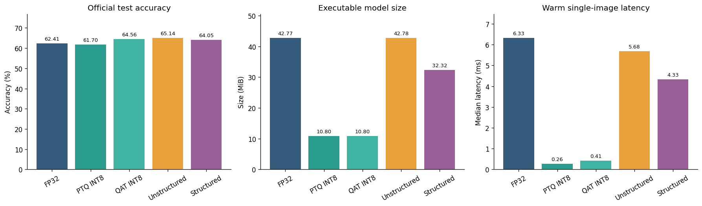
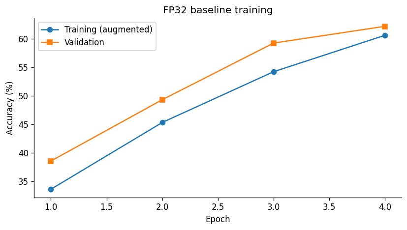

# Technical report: Assignment 3
Student: Ahmed Izaan | Section: A

## 1. Experimental setup
One quantizable torchvision ResNet-18 is trained from scratch on CIFAR-10, with a ten-class head. The original ImageNet-style stem is retained for CPU feasibility. This aggressively reduces CIFAR spatial resolution and is a limitation; the model is not claimed to be converged.

Training/validation/test: 45,000 / 5,000 / 10,000 images. Split is stratified and recorded in results/data_split.npz. Seed: 42. Batch size: 128. CPU threads: 4. Baseline epochs: 4; QAT epochs: 1; final pruning fine-tuning epochs per method: 1. SGD uses momentum 0.9 and weight decay 0.0005, with cosine learning-rate decay. Baseline LR: 0.05; QAT LR: 0.001; final unstructured LR: 0.001; structured LR: 0.002. Best FP32 epoch is selected by validation accuracy. No test examples are used in training, calibration or model selection.

## 2. Question 1 implementation
Compatible Conv-BN-ReLU groups are fused using torchvision's quantizable ResNet fusion method. PTQ inserts FBGEMM observers, calibrates on 1,000 balanced non-augmented training images and converts to true INT8 convolution/linear operations. QAT reloads exactly the same FP32 checkpoint, fuses in QAT mode, inserts fake quantizers, fine-tunes with frozen BN statistics and freezes observers halfway through the last epoch. Conversion removes training-only fake quantization and deploys real INT8 kernels.

## 3. Question 2 implementation
Unstructured pruning applies global L1 magnitude masks to all Conv2d/Linear weights. Three iterations each prune 20% of the currently surviving weights, yielding approximately 48.8% sparsity. Each iteration has one short recovery epoch on 5,000 training images. A final recovery epoch uses the full training split. Masks remain active during training and are folded permanently only afterward. A gzip checkpoint improves stored sparse-weight compressibility, but dense execution does not skip zero weights.

Structured pruning physically removes the lowest-magnitude 25% of conv1 output channels inside each of the eight residual BasicBlocks. Matching bn1 features and conv2 input channels are removed. Block output widths and projection paths stay valid, so residual additions require no arbitrary slicing. Checkpoints include the reconstructed channel widths and are successfully reloaded independently. The structured network has fewer real parameters, rather than only extra zero weights. Validation accuracy before and after recovery is recorded in results/structured_recovery.json.

## 4. Measured full-test results
| model | test_images | accuracy_pct | checkpoint_mib | latency_p50_ms | latency_p95_ms | latency_p99_ms | throughput_images_s | inference_only_seconds | threads |
| --- | --- | --- | --- | --- | --- | --- | --- | --- | --- |
| fp32 | 10000 | 62.41 | 42.7739 | 6.3303 | 8.8788 | 9.7198 | 3316.4868 | 3.0152 | 4 |
| ptq_int8 | 10000 | 61.7 | 10.797 | 0.2614 | 0.4265 | 0.5057 | 11253.0583 | 0.8886 | 4 |
| qat_int8 | 10000 | 64.56 | 10.797 | 0.4145 | 0.4646 | 0.6108 | 11584.9369 | 0.8632 | 4 |
| unstructured | 10000 | 65.14 | 42.7832 | 5.6785 | 6.8537 | 7.6174 | 3761.4932 | 2.6585 | 4 |
| structured | 10000 | 64.05 | 32.3164 | 4.3266 | 5.0003 | 6.5988 | 4595.0068 | 2.1763 | 4 |

## 5. Relative comparison
| model | accuracy_pct | checkpoint_mib | latency_p50_ms | accuracy_change_pp | size_reduction_pct | latency_speedup |
| --- | --- | --- | --- | --- | --- | --- |
| fp32 | 62.41 | 42.7739 | 6.3303 | 0.0 | 0.0 | 1.0 |
| ptq_int8 | 61.7 | 10.797 | 0.2614 | -0.71 | 74.7581 | 24.2173 |
| qat_int8 | 64.56 | 10.797 | 0.4145 | 2.15 | 74.7581 | 15.2705 |
| unstructured | 65.14 | 42.7832 | 5.6785 | 2.73 | -0.0217 | 1.1148 |
| structured | 64.05 | 32.3164 | 4.3266 | 1.64 | 24.4482 | 1.4631 |

All checkpoints are reloaded from disk before benchmarking. Accuracy covers every official test image. Twenty synthetic warm-up calls precede 100 single-image latency measurements. Batch throughput times only model forward calls over the full test dataset. Preprocessing, loading and CSV writing are excluded. Batch timings are repeated for each prediction row for auditability; the per-image amortized time is not a measured batch-size-one latency.

## 6. ONNX verification
| model | onnx_mib | checked_images | max_absolute_logit_error | prediction_agreement_pct | quantize_nodes | output_quantization_step | max_error_in_output_steps | full_test_images | onnx_test_accuracy_pct | native_test_accuracy_pct | full_test_prediction_agreement_pct | status |
| --- | --- | --- | --- | --- | --- | --- | --- | --- | --- | --- | --- | --- |
| fp32 | 42.644275 | 32 | 3e-06 | 100.0 | 0 | 0.0 | 0.0 | 10000 | 62.41 | 62.41 | 100.0 | checker and CPU execution passed |
| ptq_int8 | 10.773283 | 32 | 0.49003 | 90.625 | 33 | 0.245015 | 2.000001 | 10000 | 61.81 | 61.7 | 93.96 | checker and CPU execution passed |
| qat_int8 | 10.773283 | 32 | 0.343644 | 96.875 | 33 | 0.114548 | 3.000001 | 10000 | 64.65 | 64.56 | 96.96 | checker and CPU execution passed |
| unstructured | 42.644275 | 32 | 2e-06 | 100.0 | 0 | 0.0 | 0.0 | 10000 | 65.14 | 65.14 | 100.0 | checker and CPU execution passed |
| structured | 32.16587 | 32 | 2e-06 | 100.0 | 0 | 0.0 | 0.0 | 10000 | 64.05 | 64.05 | 100.0 | checker and CPU execution passed |

ONNX graphs pass structural checking and actual ONNX Runtime CPU execution. Logit error is checked on 32 images, and ONNX test accuracy and prediction agreement are measured on all 10,000 test images. Native and ONNX outputs are compared against the same optimized model, not an unrelated FP32 reference. Q/DQ nodes are checked in the INT8 exports. Quantized backend rounding accumulates across layers. INT8 logit error is checked against three final output quantization steps, and full-test agreement is reported explicitly. These exports are not claimed to be numerically identical to native INT8 inference.

## 7. Figures / captured notebook results

These figures reproduce the notebook outputs directly from measured experimental data. The notebook also displays the complete benchmark table, channel reconstruction table, pruning iterations and export verification results.

## 8. Limitations and interpretation
Only a short CPU training schedule is executed. Accuracy should be interpreted alongside the stem choice, training curve and small fine-tuning budget. More epochs and a CIFAR-adapted stem are possible follow-up experiments. QAT and pruning receive extra training, so a matched-training FP32 control would be required for causal claims about accuracy improvements. Four-thread CPU latency is hardware-specific. Dense unstructured pruning does not guarantee smaller raw tensors or faster kernels; the report distinguishes gzip storage compression from executable model size. Structured pruning is restricted to internal residual-block channels to preserve network dependencies. A single 100-call latency sample is an illustrative measurement rather than a rigorous multi-process performance study.

## 9. References
- Assignment 3, Edge Computing & Intelligent Systems (provided PDF).
- PyTorch quantization API: https://docs.pytorch.org/docs/stable/quantization-support.html
- PyTorch pruning tutorial: https://docs.pytorch.org/tutorials/intermediate/pruning_tutorial.html
- torchvision quantizable ResNet implementation (v0.20.1): https://github.com/pytorch/vision/blob/v0.20.1/torchvision/models/quantization/resnet.py
- CIFAR-10: https://www.cs.toronto.edu/~kriz/cifar.html
